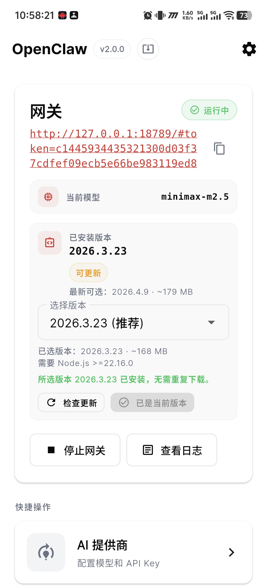
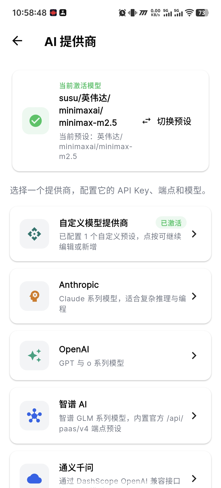
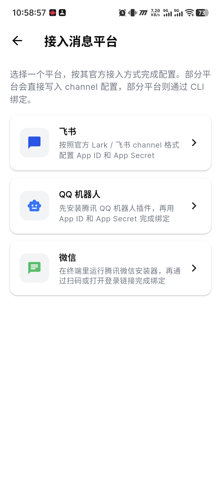
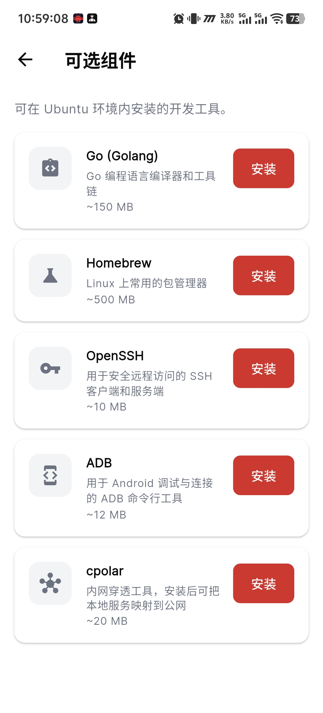
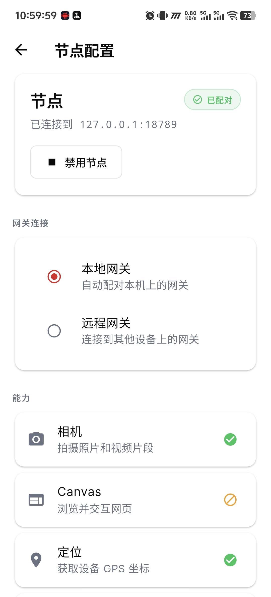
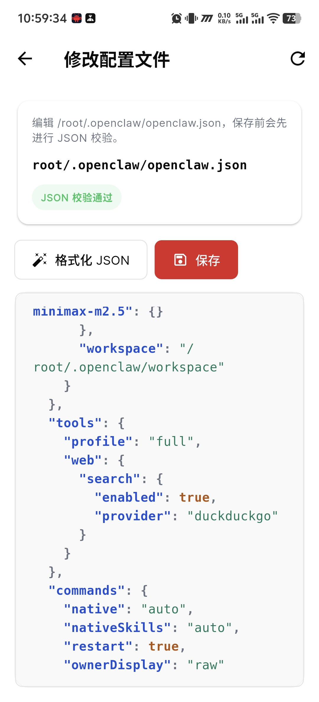
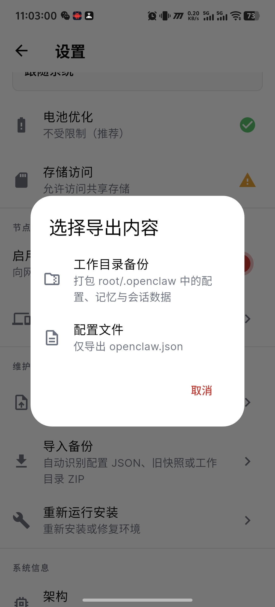
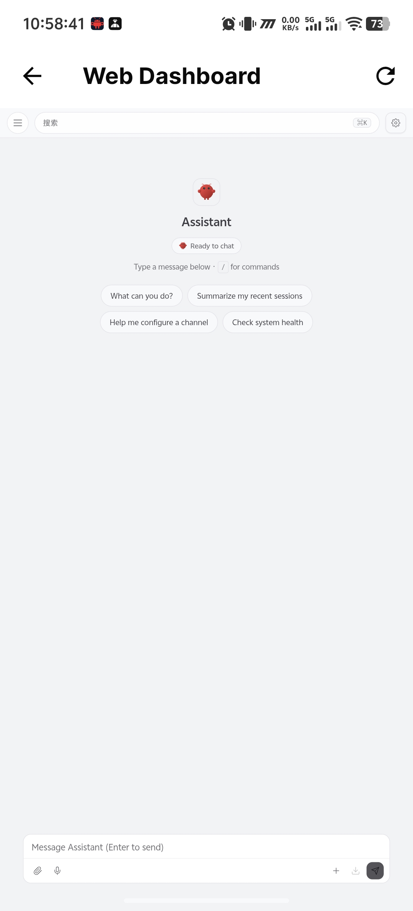

<div align="center">
  
  <h1>OpenClaw 中文整合版</h1>
  <p>
    <a href="README.md">简体中文</a> | <a href="docs/README_en.md">English</a>
  </p>
  <p>面向中文用户维护与分发的 OpenClaw Android 独立整合版本</p>
  <p>内置 Ubuntu RootFS、Node.js 与 OpenClaw 完整运行环境，重点优化中文文档、移动端配置体验与 Android 原生集成。</p>
  <p>
    
    
    
    
  </p>
  <p>
    
    
    
    
    
    
  </p>
</div>

> 本仓库为社区维护的中文整合版，主要用于中文用户维护、测试与分发。
>
> 整合来源：
> - Android 集成上游：[`mithun50/openclaw-termux`](https://github.com/mithun50/openclaw-termux)
> - 汉化基础分支：[`TIANLI0/openclaw-termux` 的 `feature/translation` 分支](https://github.com/TIANLI0/openclaw-termux/tree/feature/translation)
> - OpenClaw 核心项目：[`openclaw/openclaw`](https://github.com/openclaw/openclaw)

## 项目定位

这个仓库的目标不是简单把 OpenClaw 打成 APK，而是让中文 Android 用户更容易完成以下事情：

- 在手机上直接安装 Ubuntu RootFS、Node.js 与 OpenClaw，不依赖 Termux。
- 用中文界面完成初始化、配置、日志查看、版本切换和备份恢复。
- 在 Android 上管理 AI 提供商、消息平台、网关和节点能力。
- 更直观地编辑 `openclaw.json`、查看对话日志和恢复记忆/会话数据。

## 重要警告

> [!IMPORTANT]
> - **本仓库不是 OpenClaw 官方 Android 发布渠道，升级前请自行评估兼容性与风险**。
> - v3.0.0 ARM64 完整版 APK 内置 Ubuntu RootFS、Node.js 与 OpenClaw 2026.3.23；首次初始化从安装包本地部署，不下载这些核心组件。
> - v3.0.0 启用新的长期正式签名，不能覆盖安装 2.x。旧用户必须先导出备份，再卸载旧版、安装 3.0.0 并导入备份。
> - 导入配置或工作目录备份时，会覆盖当前 `/root/.openclaw` 下的核心数据；恢复前请先确认自己是否需要另做备份。
> - 节点能力中的 `Canvas` 目前仍是未实现状态，README 会展示能力规划，但这项功能现在不能当成已可用能力使用。
> - 如果要长时间运行 Gateway、做局域网访问或后台保持会话，建议**关闭系统电池优化**，并正确授予存储等必要权限。

## 功能亮点

- 一键安装 Android 独立运行环境：Ubuntu RootFS、Node.js、OpenClaw；大体积运行时资源默认从外部下载，显著降低 APK 体积。
- 中文首页与安装向导，可直接选择 OpenClaw 版本并完成初始化。
- 新增独立的“预构建资源配置”页，可分别填写预构建 RootFS、Ubuntu base RootFS、Node.js 三个资源链接，或分别选择本地压缩包。
- AI 提供商管理、消息平台接入、可选组件安装、节点能力配置。
- 首页快捷操作新增“本地模型和对话”与“备份中心”，更适合手机上直接操作。
- 支持在手机上安装 `llama.cpp`、下载和管理 GGUF 模型、写入本地 Provider 预设，并直接进入本地对话页测试。
- 本地对话页支持流式输出、思考开关、Markdown 渲染、停止生成、折叠头部、内存占用查看和切换其他已保存模型配置。
- 支持配置文件编辑、对话日志查看、备份导出、备份库切换与工作目录恢复。
- 支持局域网访问说明、节点日志复制、结构化对话日志展示等移动端优化。
- 支持全架构 APK 打包，便于真机与模拟器测试。

## OpenClaw 版本通道与兼容性

安装向导和首页版本卡片使用显式通道，不会用 npm 最新版静默替换稳定版：

| 通道 | OpenClaw 版本 | 默认行为 | Gateway 协议 | Node.js |
| --- | --- | --- | --- | --- |
| 内置稳定版 | `2026.3.23` | APK 本地恢复；不下载、不运行 npm install | 兼容 v3 | ARM64 使用已验证的 `24.18.1` |
| 当前最新正式版 | `2026.7.1` | 标记“最新 · 推荐”，首次升级需要联网 | 优先 v4，仅在明确协议不匹配时安全降级 | 要求 `>=22.22.3 <23 || >=24.15.0 <25 || >=25.9.0` |
| 历史版本 | npm 中 `2026.3.13` 及之后的其他版本 | 继续允许手动选择，不标记为 Stable/Experimental；更早版本不再显示 | 依据服务端能力协商 | 安装前按完整 `engines.node` 范围校验 |

版本和运行时兼容层还包含以下保护：

- v3/v4 握手、Token、deviceToken、scope 和服务端重试建议由独立协议层处理；鉴权错误不会触发协议降级，deviceToken 最多重试一次。
- 启动时区分 `fresh / complete / repairable / upgradeInterrupted / manualRecoveryRequired`；自动修复只重建 wrapper、Bionic Bypass、PRoot compatibility 和 DNS 等运行文件，不删除 RootFS、配置或用户数据。
- 升级或降级前会显示来源、目标和通道，并创建保护性快照；失败时回滚 package、command 和配置。降级保留 7.x 新增状态，但旧版可能忽略新字段。
- 自定义 Provider Base URL 只去除首尾空白，不会自动追加 `/v1`；探测请求需要的 endpoint 仅在发起请求时拼接。

详细设计和验证记录见 [兼容性分析](docs/openclaw-2026.7-compatibility-analysis.zh.md)、[实施计划](docs/openclaw-2026.7-implementation-plan.zh.md) 与 [回归记录](docs/openclaw-2026.7-regression-record.zh.md)。

## 界面截图

<table>
  <tr>
    <td align="center"><br />首页</td>
    <td align="center"><br />AI 提供商</td>
    <td align="center"><br />消息平台</td>
    <td align="center"><br />可选组件</td>
  </tr>
  <tr>
    <td align="center"><br />节点能力</td>
    <td align="center"><br />配置文件编辑</td>
    <td align="center"><br />导出备份</td>
    <td align="center"><br />WebUI 对话界面</td>
  </tr>
</table>

## 节点能力

当前 Android 端已经围绕“设备能力接入 Gateway”做了基础支持，能力状态如下：

| 能力 | 状态 | 说明 |
| --- | --- | --- |
| Camera | ✅ 已接入 | 拍照和视频片段采集 |
| Location | ✅ 已接入 | 获取设备 GPS 坐标 |
| Screen Recording | ✅ 已接入 | 录制设备屏幕，每次都需要授权 |
| Flashlight | ✅ 已接入 | 控制手电筒开关 |
| Vibration | ✅ 已接入 | 触发振动和触觉反馈 |
| Sensors | ✅ 已接入 | 读取加速度计、陀螺仪、磁力计、气压计等 |
| Serial | ✅ 已接入 | 蓝牙和 USB 串口通信 |
| Canvas | ⏳ 暂未启用 | 当前 Android 端 WebView Canvas capability 仍未实现 |

补充说明：

- 节点页支持本地网关和远程网关两种连接方式。
- 已加入节点日志查看与复制，方便排查连接和配对问题。
- `Canvas` 在代码里是明确返回 `NOT_IMPLEMENTED` 的占位实现，不是隐藏入口。

## 架构图

下面是这个整合版的大致结构：

<div align="center">
  
</div>

可以简单理解为：

- `flutter_app/` 负责 Android 端 UI、权限、安装流程和原生能力桥接。
- PRoot 里的 Ubuntu 负责承载 Node.js 与 OpenClaw CLI / Gateway 运行环境。
- `/root/.openclaw` 负责保存配置、记忆、技能、扩展和会话等核心数据。
- 节点能力是 Android 设备侧的补充能力层，通过配对后向 Gateway 暴露设备能力。

## 当前正式发布版本

- 版本：`v3.0.0`
- 发布说明：[release/v3.0.0/Release.zh.md](release/v3.0.0/Release.zh.md)
- 改动日志：[CHANGELOG.md](CHANGELOG.md)
- v3.0.0 发布页：<https://github.com/JunWan666/openclaw-termux-zh/releases/tag/v3.0.0>

> v2.0.3 Release 已撤回。v3.0.0 当前只发布 ARM64 完整版。

## v3.0.0 重点亮点

- ARM64 APK 内置 Ubuntu 24.04.3、Node.js 24.18.1、npm 11.16.0 和 OpenClaw 2026.3.23，首次初始化不再下载或执行完整 npm install。
- 重构欢迎、初始化进度、部署动态和完成页面，提供阶段状态、平滑进度与脱敏日志。
- 默认配置 `7749API（ywd 公益）`，支持在线拉取模型列表和切换模型。
- OpenClaw 2026.7.1 标记“最新 · 推荐”；内置 2026.3.23 可快速本地恢复。
- 升降级使用保护事务并缓存完整版本快照，再次切回可跳过下载和 npm install。
- npm 持久缓存默认 1 GB，支持自定义容量并按旧文件渐进淘汰。
- 优化 Gateway 冷启动、Web 控制台连接、配置迁移和页面提示位置。
- 完整 Flutter 测试集共 139 项通过。

## 下载指南

> 当前内置运行环境仅支持 ARM64，不发布 Universal、ARMv7 或 x86_64 完整版。

| 文件 | 适用设备 | 大小 | 下载 |
| --- | --- | ---: | --- |
| `OpenClaw-v3.0.0-arm64-v8a-full.apk` | Android 10+ ARM64 手机和平板 | 331.90 MiB | [点击下载](https://github.com/JunWan666/openclaw-termux-zh/releases/download/v3.0.0/OpenClaw-v3.0.0-arm64-v8a-full.apk) |

## 快速开始

### 方式一：Android APK（推荐）

1. 旧用户先通过备份中心导出重要数据，再卸载旧签名版本。
2. 安装 ARM64 完整版，打开应用并完成本地初始化。
3. 在完成页点击“进入 OpenClaw”，按需导入旧版备份。
4. 启动 Gateway，点击首页地址打开 Web 控制台。

### 方式二：源码构建

```bash
git clone https://github.com/JunWan666/openclaw-termux-zh.git
cd openclaw-termux-zh
git lfs pull
python scripts/build_release.py --version 3.0.0 --build-number 81 --non-interactive
```

发布脚本只生成与内置运行环境匹配的 ARM64 完整版 APK。

## 交流反馈

如需交流使用经验、排查问题或反馈建议，欢迎加入 `OpenClaw-zh` 开源项目交流群。

<div align="center">
  
  <p>微信扫码加入交流群</p>
</div>

## 更多文档

- [CHANGELOG.md](CHANGELOG.md)
- [docs/jsonl_format_guide.md](docs/jsonl_format_guide.md)
- [docs/README_en.md](docs/README_en.md)
- [release/v3.0.0/Release.zh.md](release/v3.0.0/Release.zh.md)

## Star History

<a href="https://www.star-history.com/?repos=JunWan666%2Fopenclaw-termux-zh&type=date&legend=top-left">
 <picture>
   <source media="(prefers-color-scheme: dark)" srcset="https://api.star-history.com/chart?repos=JunWan666/openclaw-termux-zh&type=date&theme=dark&legend=top-left&sealed_token=3fhNBkM05BEaiplfXAQqss3WKDVm07YucoWP4Jj7xAMYeoamPxoKKWjHWe1351GtIRlOHuOr_niq9R27sAR5kVqT10ie6fhRs4emcBTEDc3P4U9dDCd79ENAY5xqlB_Svvt8zUy-cNKKHOYn4sDEO0dgvKhyJkEFGonI31o771eyrAHj76hXSl03YvTV" />
   <source media="(prefers-color-scheme: light)" srcset="https://api.star-history.com/chart?repos=JunWan666/openclaw-termux-zh&type=date&legend=top-left&sealed_token=3fhNBkM05BEaiplfXAQqss3WKDVm07YucoWP4Jj7xAMYeoamPxoKKWjHWe1351GtIRlOHuOr_niq9R27sAR5kVqT10ie6fhRs4emcBTEDc3P4U9dDCd79ENAY5xqlB_Svvt8zUy-cNKKHOYn4sDEO0dgvKhyJkEFGonI31o771eyrAHj76hXSl03YvTV" />
   
 </picture>
</a>

## 免责声明

本仓库为社区维护的中文整合版本，不代表 OpenClaw 官方发布。若用于生产环境，请自行评估兼容性、升级风险与数据安全策略。

## 许可证

MIT，详见 [LICENSE](LICENSE)。
